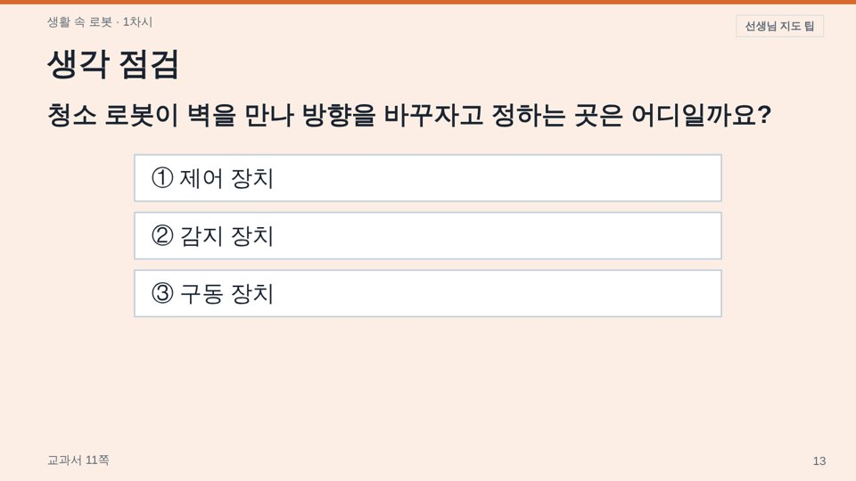

# lesson-builder

**초등 교과서 한 차시(또는 묶음 차시) 수업자료를 만드는 AI 스킬**입니다.
교과서와 지도서 PDF를 넣으면 AI가 정해진 순서(성취기준 → 평가 → 교과서 근거 → 교사 승인 → 그림·영상 → 제작 → 검사 → 수정 반영)를 따라 아래 세 가지를 만듭니다.

| 결과물 | 형식 | 용도 |
|---|---|---|
| 화면용 수업자료 | HTML 한 파일 (차시 탭, 전체화면, 키보드 넘기기) | 교실 TV·전자칠판에 띄우는 PPT 대신 |
| 활동지 | HTML (Ctrl+P로 인쇄) | 학생 배부 |
| 수업안 | Markdown (요청하면 한글 `.hwpx`) | 수업 계획·결재 |


> 현직 초등 교사가 Claude와 함께 6학년 실과 수업에 실제로 쓰면서 다듬은 스킬입니다. 검증된 교과는 **6학년 실과**이고, 다른 교과·학년은 교과별 흐름 문서를 더해 넓혀 갈 수 있습니다.

---

## 목차
1. [왜 만들었나요](#1-왜-만들었나요)
2. [특징](#2-특징)
3. [작업 순서 0~9단계](#3-작업-순서-09단계)
4. [폴더 구조](#4-폴더-구조)
5. [준비물](#5-준비물)
6. [설치와 사용법](#6-설치와-사용법)
7. [먼저 체험해 보기 (가상 예시)](#7-먼저-체험해-보기-가상-예시)
8. [슬라이드 종류](#8-슬라이드-종류)
9. [사용한 외부 도구·MCP와 출처](#9-사용한-외부-도구mcp와-출처)
10. [저작권과 주의 사항](#10-저작권과-주의-사항)
11. [라이선스](#11-라이선스)

---

## 1. 왜 만들었나요

AI에게 "수업 PPT 만들어 줘"라고 하면 그럴듯하지만 **교과서와 다른 내용**, **성취기준과 맞지 않는 목표**, **이모지로 꾸민 'AI 티 나는' 화면**이 나오기 쉽습니다.
이 스킬은 AI가 바로 자료를 만들지 못하게 하고, 교사가 수업을 준비하는 순서 그대로 단계마다 **완료 기준을 통과해야 다음으로 넘어가게** 했습니다.

- 성취기준 원문은 **기억이 아니라 교육과정 데이터(MCP) 두 곳에서 대조**해 가져옵니다.
- 평가(무엇을 보면 배웠다고 할 수 있나)를 **먼저** 설계하고, 활동은 평가 증거를 만드는 것만 넣습니다.
- 화면의 모든 내용에 **교과서·지도서 쪽 번호**가 붙습니다. 교과서에 없는 설명은 "더 알아보기"로 따로 표시합니다.
- 수업 흐름은 **교사가 승인해야** 제작을 시작합니다.

## 2. 특징

- **교과서 중심**: 교과서·지도서 그림을 먼저 쓰고, 본문 캡처에 색연필 형광펜·별표를 달아 함께 읽고 시작합니다.
- **뒷자리까지 보이는 글씨**: 1600×900 화면 기준 본문 52px 이상 같은 최소 크기를 검사합니다.
- **누를 때마다 하나씩**: 비교 그림, 예시 답안, 정답 확인이 클릭할 때 나타납니다.
- **성장 언어**: "부족", "미흡", "하 수준" 대신 "시작하는 중 → 다음 성장 방향"으로 씁니다.
- **생각 점검(힌지 질문)**: 선택지마다 학생이 가진 생각과 교사의 대응 방법을 담고, 화면의 '선생님 지도 팁' 버튼으로 봅니다.
- **자동 검사**: 금지 표현, 쪽 번호 누락, 장수, 글씨 넘침을 스크립트가 확인합니다.
- **유튜브 오류 153 대응**: 파일로 열어도 '유튜브에서 보기' 버튼이 나오고, 같은 폴더의 실행 파일로 열면 화면 안에서 재생됩니다.

| 사람과 로봇 비교 (누를 때마다 한 줄씩) | 생각 점검 + 선생님 지도 팁 |
|---|---|
|  |  |

## 3. 작업 순서 0~9단계

| 단계 | 이름 | 산출물 | 넘어가는 조건 |
|---|---|---|---|
| 0 | 입력 확인 | `input.json` | 학년·교과·단원·차시·쪽 범위, 교과서·지도서 PDF 확인 |
| 1 | 교육과정 분석 | `curriculum.json` | 성취기준 원문 두 출처 일치 (불일치면 멈추고 교사에게 질문) |
| 2 | 평가 먼저 설계 | `assessment.json` | 지식·기능·태도 목표, 성공 기준, 확인 질문 3개, 금지 표현 0개 |
| 3 | 교과서 근거 추출 | `evidence.json` | 모든 항목에 쪽 번호, 추출 그림 전부 확인 |
| 4 | 수업 흐름 설계 | `flow.json` | **교사 승인** |
| 5 | 그림·영상 고르기 | `lesson.json`의 `media` | 모든 그림·영상에 출처와 라이선스 |
| 6 | 제작 | HTML·활동지·수업안 | 빌드 오류 없음 |
| 7 | 품질 검사 | `qa-report.md`, 화면 캡처 | 실패 0개, 넘친 슬라이드 0개 |
| 8 | 산출·보고 | 교사에게 보고 | 보충 내용·빈 자리·출처 목록 보고 |
| 9 | 교사 수정 반영 | 고친 `lesson.json` | 같은 지적이 두 번 나오면 규칙 문서에 기록 |

자세한 내용은 [SKILL.md](SKILL.md)에 있습니다. AI는 이 파일을 읽고 일합니다.

## 4. 폴더 구조

```
lesson-builder/
├── SKILL.md                 AI가 따르는 작업 설명서 (0~9단계)
├── references/              규칙 문서
│   ├── slide-style.md       교사가 정한 화면 규칙 (가장 우선)
│   ├── design-system.md     색·글꼴·배치
│   ├── growth-language.md   성장 언어 규칙과 금지 표현
│   ├── media-policy.md      그림·영상 고르는 순서와 출처 기록
│   ├── activity-catalog.md  검증된 활동과 거절된 방식
│   ├── qa-checklist.md      검사 항목
│   ├── subject-flows/       교과별 수업 흐름 틀 (지금은 실과.md)
│   ├── environment.md       Claude에서 실제로 확인한 도구 사용법
│   └── platforms.md         Claude·안티그래비티·ChatGPT별 안내
├── templates/               화면용(editorial.html/js)·활동지 템플릿
├── scripts/
│   ├── build.py             lesson.json → 화면용·활동지·수업안
│   ├── check.py             자동 품질 검사 → qa-report.md
│   ├── shots.js             모든 슬라이드 캡처, 넘침 찾기 (Playwright)
│   ├── contact_sheet.py     추출 그림 모아보기
│   ├── mcp_call.py          교육과정 MCP를 직접 호출
│   └── doctor.py            필요한 도구가 있는지 확인
├── schemas/                 단계별 JSON 형식
├── examples/sample_robot_1/ 가상 예시 (0~8단계 파일 전체)
└── docs/                    README 그림
```

**핵심 원칙: 내용은 `lesson.json`에만 씁니다.** HTML은 `build.py`가 템플릿으로 만들기 때문에, 디자인을 고치면 모든 단원에 한 번에 반영됩니다.

## 5. 준비물

| 준비물 | 필요한 단계 | 없으면 |
|---|---|---|
| Python 3 + Pillow | 6 (그림 줄이기) | 그림이 원본 크기로 들어가 파일이 커짐 |
| Node.js (npx) | 1 (교육과정 MCP), 3 (kordoc으로 PDF 읽기) | 성취기준을 단일 출처로 확인, PDF를 다른 방법으로 읽음 |
| poppler (`pdftoppm`, `pdftotext`) | 3 (교과서 본문 캡처·형광펜 위치) | 본문 캡처 슬라이드를 직접 만듦 |
| OpenCV (`opencv-python`) | 3 (교과서 QR 영상 링크 읽기) | 교사가 링크를 직접 알려 줌 |
| Playwright | 7 (화면 캡처 검사) | 교사가 화면을 열어 직접 확인 |
| 교과서·지도서 PDF | 3 | **각자 준비** (출판사 저작물이라 저장소에 없음) |

한 번에 확인하기:
```bash
python3 scripts/doctor.py
```

설치 예시 (macOS):
```bash
brew install python node poppler
pip3 install pillow opencv-python
npm i -g playwright && npx playwright install chromium
```

## 6. 설치와 사용법

### Claude Code
```bash
git clone https://github.com/Dongnyeok-code/lesson-builder.git ~/.claude/skills/lesson-builder
```
그다음 Claude Code에서 이렇게 요청합니다.
> 6학년 실과 7단원 1~3차시 수업자료 만들어 줘. 교과서 106~109쪽이야. PDF는 `~/수업/수업자료/6학년_실과/원본/`에 있어.

### Claude 앱 (claude.ai, 데스크톱)
저장소를 zip으로 내려받아(초록색 **Code → Download ZIP**) Claude 설정의 스킬 메뉴에서 올립니다. 메뉴 위치는 바뀔 수 있으니 [Claude 도움말](https://support.claude.com)을 확인하세요.
데스크톱 앱에서 내 컴퓨터 폴더를 연결하면 교과서 PDF를 바로 읽고 결과를 그 폴더에 저장합니다.

### 구글 안티그래비티 / ChatGPT
[references/platforms.md](references/platforms.md)에 폴더 위치와 달라지는 점(인터넷 검색, 화면 검사)을 정리했습니다.

### 작업 폴더 (권장)
```
수업자료/
└── 6학년_실과/
    ├── 원본/                 교과서·지도서 PDF
    ├── 7단원.md              단원 요약 (성취기준, 차시별 쪽 범위)
    └── 7단원/
        └── 1_3차시_build/    AI가 만드는 작업 폴더 (단계별 JSON, 그림, 결과물)
```

## 7. 먼저 체험해 보기 (가상 예시)

교과서 없이도 결과물 모양을 볼 수 있습니다.
```bash
cd lesson-builder
python3 scripts/build.py examples/sample_robot_1/lesson.json
python3 scripts/check.py examples/sample_robot_1
open examples/sample_robot_1/1차시_화면용.html      # 윈도: start
```
- `←` `→` 또는 스페이스: 넘기기 / 숫자 `1` `2` `3`: 차시 탭 / 전체화면 버튼
- 예시는 20장이라 "30장 미만" 경고가 나옵니다. 실제 차시는 30장 이상으로 만듭니다.

## 8. 슬라이드 종류

`lesson.json`의 `sessions[].slides[]`에 `type`으로 적습니다. 형식은 [schemas/lesson.schema.json](schemas/lesson.schema.json)과 가상 예시를 보세요.

| type | 쓰임 |
|---|---|
| `title` | 표지 |
| `goals`, `criteria` | 학습 목표, 성공 기준 (비워 두면 assessment에서 자동) |
| `reveal` | 질문을 하나씩 공개 (생각 열기) |
| `word` | 낱말 알기 (한자어·영어 낱말 → 쉬운 뜻 → 생활 예시) |
| `textbook` | 교과서 본문 캡처 + 형광펜·별표 |
| `section` | 소제목 (다음에 무엇을 할지) |
| `text`, `image`, `stage` | 설명, 큰 그림, 그림+설명 (`big`, `hide`=예시 답안 숨김) |
| `cards` | 카드 2~4장 (`list: true`면 번호 목록) |
| `compare` | 두 그림 비교, 누를 때마다 한 줄씩 |
| `fillblank` | 빈칸·순서 맞추기 (`?` 칸이 빈칸) |
| `video` | 유튜브(`videoId`) 또는 출판사 영상(`embedUrl`) |
| `oxquiz`, `hinge` | OX 퀴즈, 생각 점검 |
| `activity`, `write` | 활동 안내, 쓰기 |
| `exit`, `self_check` | 출구표, 자기 점검 |
| `sources`, `closing` | 자료 출처 (media에서 자동), 마무리 |

## 9. 사용한 외부 도구·MCP와 출처

이 스킬은 아래 오픈소스와 공개 데이터를 **호출해서** 씁니다. 저장소에 그 코드나 데이터를 복사해 넣지 않았고, 실행할 때 `npx` 등으로 각 공식 배포본을 받아 씁니다. 각 도구의 라이선스는 해당 저장소를 따릅니다.

### 교육과정 MCP (1단계: 성취기준 원문 대조)

| 이름 | 하는 일 | 출처 | 라이선스 |
|---|---|---|---|
| **korean-elementary-learning-map-mcp** | 2022 개정 초등 교육과정 성취기준 원문, 학습 주제, 선수 관계 (`get_standard`, `get_topic`, `get_prerequisites`, `search_standards`) | [taehyeonglim/korean-elementary-learning-map-mcp](https://github.com/taehyeonglim/korean-elementary-learning-map-mcp) · npm [`korean-elementary-learning-map-mcp`](https://www.npmjs.com/package/korean-elementary-learning-map-mcp) | MIT |
| **korea-learning-map-mcp** | 2022 개정 교육과정(교육부 고시 제2022-33호) 전 교과 성취기준 원문, 해설·고려 사항 (`get_topic` 등) | [jalnanco/korea-learning-map](https://github.com/jalnanco/korea-learning-map) · npm [`korea-learning-map-mcp`](https://www.npmjs.com/package/korea-learning-map-mcp) | MIT |

두 MCP는 `scripts/mcp_call.py`가 `npx -y <패키지>`로 직접 실행하므로, AI 앱에 MCP를 따로 등록하지 않아도 됩니다. 앱에 등록해서 쓰고 싶다면 설정 예시는 다음과 같습니다.
```json
{
  "mcpServers": {
    "curriculum-kr": { "command": "npx", "args": ["-y", "korean-elementary-learning-map-mcp"] },
    "korea-learning-map": { "command": "npx", "args": ["-y", "korea-learning-map-mcp"] }
  }
}
```

성취기준 원문 자체의 출처: **교육부 고시 제2022-33호 [별책 10] 실과 교육과정**, [국가교육과정정보센터(NCIC)](https://ncic.re.kr). 고시는 저작권법 제7조에 따라 보호받지 않는 저작물입니다.

### 문서·화면 도구

| 이름 | 쓰는 곳 | 출처 | 라이선스 |
|---|---|---|---|
| **kordoc** | 3단계 교과서·지도서 PDF/HWP 읽기, 8단계 수업안 `.hwpx` 만들기 | [chrisryugj/kordoc](https://github.com/chrisryugj/kordoc) · npm [`kordoc`](https://www.npmjs.com/package/kordoc) | MIT |
| **PDF.js** (`pdfjs-dist`) | kordoc의 PDF 읽기 | [mozilla/pdf.js](https://github.com/mozilla/pdf.js) | Apache-2.0 |
| **Poppler** (`pdftoppm`, `pdftotext`) | 교과서 본문 캡처, 낱말 좌표 | [poppler.freedesktop.org](https://poppler.freedesktop.org) | GPL (별도 설치, 저장소에 포함하지 않음) |
| **Playwright** | 7단계 화면 캡처 검사 | [microsoft/playwright](https://github.com/microsoft/playwright) | Apache-2.0 |
| **Pillow** | 그림 줄이기(WebP) | [python-pillow/Pillow](https://github.com/python-pillow/Pillow) | MIT-CMU |
| **OpenCV** | 교과서 QR 코드 읽기 | [opencv/opencv](https://github.com/opencv/opencv) | Apache-2.0 |
| **Pretendard** 글꼴 | 화면용·활동지 글꼴 (CDN으로 불러옴) | [orioncactus/pretendard](https://github.com/orioncactus/pretendard) | SIL OFL 1.1 |

### 그림·영상 (5단계, 수업마다 다름)
- 교과서·지도서 그림: 교사가 가진 PDF에서 추출, **수업 목적 이용**으로만 씀 (저장소에 올리지 않음)
- 위키미디어 공용: 공공영역·CC BY·CC BY-SA만, 저자·라이선스를 `media`에 기록
- 유튜브: 내려받지 않고 **임베드만** 함, 제목·채널·길이 기록
- 모든 출처는 화면용 자료의 '자료 출처' 슬라이드에 자동으로 나옵니다.

## 10. 저작권과 주의 사항

- **교과서·지도서 PDF와 거기서 뽑은 글·그림은 출판사 저작물입니다.** 저장소에 올리지 않도록 `.gitignore`에 넣어 두었습니다. 만든 수업자료는 자기 수업에서만 쓰고, 공개 게시판·블로그에 올리지 마세요.
- `examples/sample_robot_1`은 지어낸 가상 예시라 교과서 내용이 없습니다.
- 학생 실명·개인정보는 넣지 않습니다.
- 저작권 있는 노래 가사는 화면 글자로 넣지 않습니다.
- AI가 보충한 내용("더 알아보기")은 수업 전에 교사가 사실인지 확인해 주세요.

## 11. 라이선스

이 저장소의 코드·템플릿·문서는 [MIT License](LICENSE)입니다. 외부 도구와 데이터는 9절에 적은 각 라이선스를 따릅니다.

만든 사람: [Dongnyeok-code](https://github.com/Dongnyeok-code) (초등 교사) · Claude와 함께 만들었습니다.
